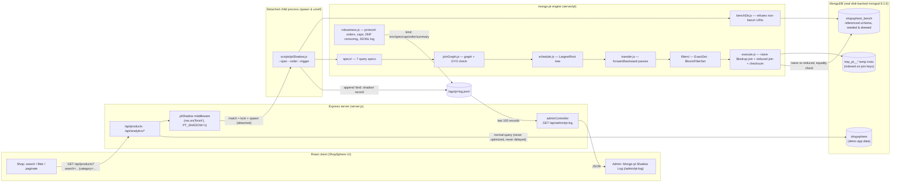
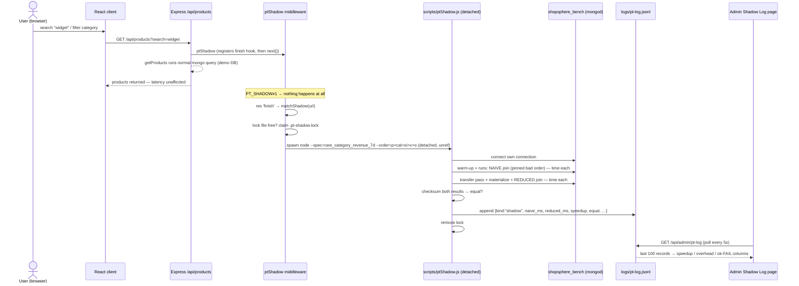
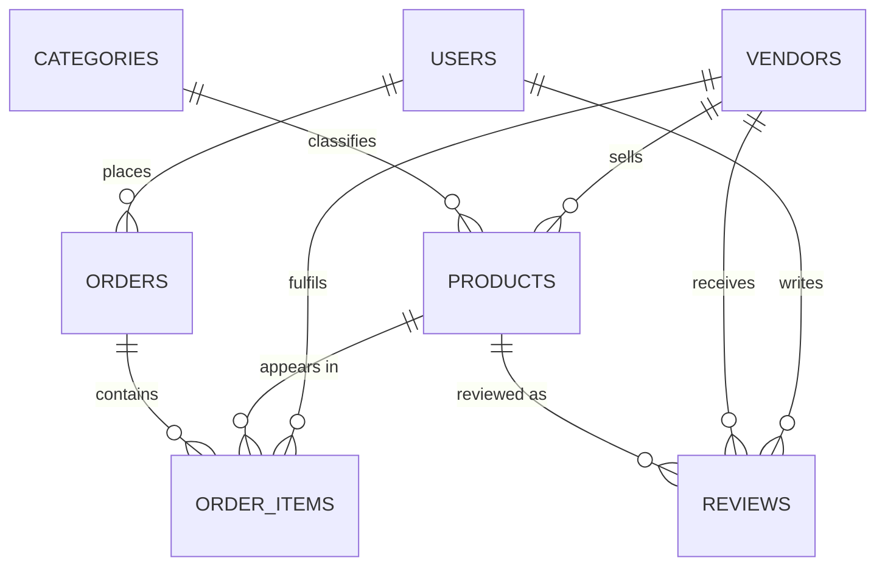

# mongo-pt — Predicate Transfer for MongoDB
### Project Review Document (DBMS course project — query optimization)

---

## 1. What the project is

**mongo-pt** is a working implementation of the **Robust Predicate Transfer (RPT)** algorithm for MongoDB, on top of a real multi-vendor e-commerce application (**ShopSphere**: React client + Express/MongoDB backend).

The project's core question:

> *Can we make MongoDB analytics queries robust to a bad join order — i.e., make the join phase insensitive to the order in which collections are joined?*

The answer — taken from the paper *"Debunking the Myth of Join Ordering: Toward Robust SQL Analytics"* (SIGMOD 2025) — is **semi-join reduction ("predicate transfer")**: before joining anything, push the effect of every *selective local filter* through the whole join graph **forward and backward**, so every collection enters the join already reduced to essentially the rows that contribute to the final answer. After that reduction, **every join order produces roughly the same runtime**, because every intermediate result is bounded by the final output size.

### What the system actually does (one paragraph)

The engine takes a declarative **query spec** (collections, local filters, equality join edges, grouping), builds a **join graph**, verifies it is **acyclic**, computes the paper's **LargestRoot transfer schedule** (a maximum-weight spanning tree rooted at the largest relation), executes a **forward + backward semi-join pass** from Node.js (exact key sets pushed as batched `$in` filters), **materializes** the reduced instances into temp collections with indexes on their join keys, then finally joins the reduced instances with `$lookup` in **any** join order. The benchmark harness times **naive join** vs **reduced join** across multiple join orders, verifies **result equality by checksum**, and logs one JSON record per line to a JSONL log that a **React admin dashboard** displays live.

### Key claims demonstrated with measured data

| Claim | Measured evidence (medium scale, mongod 8.2.6) |
|---|---|
| Naive joins are strongly order-sensitive | `rare_category_revenue_7d`: naive median **54,878 ms**, gap across orders **13.5×**, worst order 102,187 ms |
| Predicate transfer removes the order-sensitivity gap | same spec, reduced join: **17 ms median**, per-order gap collapses to **≈1.2×** |
| Total win including transfer overhead | naive ≈54.9 s vs transfer (823 ms) + materialization (126 ms) + join (17 ms) ≈ **1.0 s → ~54×** end-to-end |
| Bad cases are reported honestly, not hidden | `low_rating_reviews_by_category` (smoke): reduced total **1,012 ms ≥ naive 777 ms** — reported as "did not help" |
| Bloom-filter path is correct but slower (negative result) | bloom mode on rare-category spec: transfer **19,129–20,054 ms** vs exact **122–151 ms**, zero false negatives |

---

## 2. Motivation & problem statement

MongoDB's aggregation pipeline executes `$lookup` joins in the order the developer writes them. Developers, following typical "start with the fact table" intuition, write orders such as `order_items ▹ orders ▹ order_items ▹ ...` that are catastrophically slow when a *selective dimension filter* (a rare category, a time window, one vendor) should have pruned everything first. The problem:

1. **Join order matters enormously** — even though classical theory claims join ordering is unnecessary *given full semi-join reduction*, MongoDB offers no such reduction.
2. **No optimizer hook** — MongoDB cannot build/probe Bloom filters or schedule semi-joins inside the plan; everything must be orchestrated from the application layer.
3. **Selective vs unselective** — a reduction wins when filters are selective (rare category) and is pure overhead when they remove almost nothing (common category over 365 days). The system must measure, detect, and report both honestly.

---

## 3. Literature review

### 3.1 Primary paper

> **Junyi Zhao, Kai Su, Yifei Yang, Xiangyao Yu, Paraschos Koutris, Huanchen Zhang.**
> *"Debunking the Myth of Join Ordering: Toward Robust SQL Analytics."* **SIGMOD 2025**. arXiv:2502.15181.

Central thesis: a query optimizer does not need a good cardinality estimator if, **before joining**, the system pushes the effect of all predicates through the entire join graph in *both* directions. Then the cost of the join phase is nearly identical for **any connected join order**, so a bad estimate can no longer turn a 3-second plan into a 3-hour plan. Paper contributions reproduced here:

- **Robust Predicate Transfer (RPT)** = Yannakakis-style semi-join reduction, with schedule computed by **LargestRoot**.
- **LargestRoot (paper's Algorithm 1)** — Prim's *maximum*-spanning tree from the largest relation. Weight of edge `{R,S}` = number of shared join attributes (Lemma 3.2 makes the tree a **join tree**, which makes the reduction *complete* for acyclic queries).
- **SafeSubjoin** — guarantees a chosen join order is blowup-free for acyclic-but-not-γ-acyclic queries. **Skipped in this project** (allowed by the brief when unneeded): every benchmark spec is γ-acyclic — every pair of relations shares exactly one attribute, so *every* connected join order is enumeration-safe.
- **Bloom-filter operators (`CreateBF`/`ProbeBF`)** — the paper inserts these into DuckDB's optimizer. MongoDB has no such hook; see §3.3 and §11 for our adaptation and its negative result.

### 3.2 Seminal prior work

- **Yannakakis (1981)** — "*Algorithms for acyclic database schemes*": acyclic conjunctive queries can be answered in polynomial time by a **full reducer** — forward (leaf→root) then backward (root→leaf) semi-join passes bound every intermediate result by the output size. This is exactly the two-pass skeleton mongo-pt runs.
- **Bernstein & Goodman (1981)** — semi-joins for distributed query processing: ship only the join-key sets ("predicates"), not tuples. Our "transfer" step is a Bernstein semi-join implemented as `{field: {$in: keys}}` inside one mongod.
- **GYO / Graham-Yao ear removal** — the classical α-acyclicity test: repeatedly remove an "ear" whose neighbors form a clique. mongo-pt runs this to *reject* cyclic specs before any transfer work, exactly as the paper's theory requires (no join tree ⟹ no complete reduction).
- **γ-acyclicity (Fagin 1983)** — the subclass for which pairwise semi-join reduction is complete; sufficient test = no two relations joined on more than one attribute (composite-key joins). All our specs qualify.

### 3.3 Bloom filters

- **Bloom (1970)**; **Fan et al. / Mueller et al.** for use in joins and data skipping. A Bloom filter represents a key set in tiny space with possible **false positives but zero false negatives**.
- In the paper's DuckDB context, Bloom filters are the *cheap bandwidth* alternative to shipping key sets. In MongoDB's aggregation language there is **no way to build or probe a Bloom filter inside a normal query plan**, so mongo-pt (a) exposes a client-side Bloom filter to the server via a `$function` operator (experimental, `PT_BLOOM=1`), and (b) reports the outcome as a **negative result**: correct (0 false negatives, verified by `tests/bloom.test.js` on 120k mixed keys) but **~2 orders of magnitude slower** than a batched exact `$in` set (§10.3), because the `$function` kills index usage.

### 3.4 Related systems (context)

- **Snowflake / predicate-pushdown datasharing** and **materialized-view & semi-join reducers** in commercial engines — the same "push selection before join" family.
- **MongoDB `$lookup`** — left/outer nested-loop-style correlate; index support on `foreignField` is what makes the reduced join fast. mongo-pt materializes reduced relations with indexes on join keys to guarantee this.
- **Robustness line of work** (e.g., "Robust Query Processing" surveys; LEO/Postgres feedback loops) — alternatives to predicate transfer that fix estimates *after* observing misestimates; predicate transfer instead makes estimates unnecessary for the join phase.

---

## 4. Architecture

### 4.1 High-level component diagram



### 4.2 Request flow — what happens when a user clicks/searches



Rules enforced by design:

- **Never blocks or breaks the request** — the hook is `res.on('finish')`, the child is detached with its own connection, all failures swallowed.
- **Never touches app data** — the child reads/writes only `shopsphere_bench`; `benchDb.js` *refuses* any URI whose database is not `shopsphere_bench`.
- **Single-flight** — a lock file (stale after 15 min, so a crashed run can't block forever) prevents piles of concurrent benchmarks from repeated searches.
- **Relevance gating** — the product route fires only on `search`/`category` (hompage pagination loads never trigger a benchmark). The pinned order `p>cat>oi>v>o` is deliberately expensive so the win is visible live.
- **Off by default** — requires `PT_SHADOW=1`.

### 4.3 Repository layout (relevant parts)

```
docs/                     # design, ER schema, results (md/csv/html charts)
server/
  pt/
    specs/index.js        # 7 benchmark query specs (declarative)
    schema/index.js       # bench schema models (referenced/normalized)
    joinGraph.js          # join graph build + GYO acyclicity check
    schedule.js           # LargestRoot transfer schedule (paper Alg. 1)
    transfer.js           # forward/backward semi-join passes
    filters/index.js      # FilterSet: ExactSet (default) / BloomFilterSet
    execute.js            # naive join, reduced join, checksum, equality
    robustness.js         # full protocol: runs, caps, DNF censoring, logging
    benchDb.js            # connection guard (shopsphere_bench only)
  scripts/
    seedBench.js          # deterministic seeded, skewed seeder
    ptShadow.js           # one shadow measurement = own process
    ptSchedule/ptExecute/repro.js
  middleware/ptShadow.js  # express middleware (spawn-on-finish)
  routes/productRoutes.js # ptShadow mounted on GET /api/products
  routes/analyticsRoutes.js
  controllers/adminController.js  # GET /api/admin/pt-log
  benchmarks/report.js    # docs/results.md + csv + chart html generator
  tests/                  # node --test: transfer, pt, bloom
client/src/pages/PtLogPage.jsx  # shadow log table (polls every 5 s)
semijoin-benchmark.js    # standalone naive vs semi-join micro-benchmark
```

---

## 5. Benchmark schema and data

### 5.1 Schema (ER)

The benchmark lives in a dedicated database with a **referenced (normalized)** schema so joins are real joins. The demo app DB (with embedded `orders.items[]`) is never touched.



| Collection | Key fields | Join keys (all indexed) |
|---|---|---|
| `users` | name, email | `_id` |
| `vendors` | name, rating | `_id` |
| `categories` | name, **`is_rare`** | `_id` |
| `products` | name, price, stock | `vendor_id`, `category_id` |
| `orders` | status, total_amount | `user_id`, **`created_at`** |
| `order_items` | quantity, price, **`line_total`** | `order_id`, `product_id`, `vendor_id`, **`created_at`** |
| `reviews` | rating | `product_id`, `user_id`, `vendor_id` |

### 5.2 Deliberate skew (deterministic seeder)

- **Category 0 rare** (~0.5 % of products, `is_rare: true`); category 1 very common (~40 %).
- **Zipf-like vendor sizes** (vendor 0 largest).
- **Orders spread uniformly over the last 365 days** (so a 7-day window is selective; 365-day is not).
- A small **"hot" product set** (first 0.1 %, min 5) receives ~30 % of order-item picks.

### 5.3 Scales

| Flag | products | orders | order_items | vendors | categories | users | reviews |
|---|---|---|---|---|---|---|---|
| default (full) | 200,000 | 1,000,000 | 4,000,000 | 200 | 50 | 100,000 | 1,000,000 |
| medium (results used) | 50,000 | — | 400,656 | 100 | — | — | — |
| small (smoke/tests) | 3,000 | 228–12,000 | 47,987 | 20 | 12 | 1,016 | — |

Benchmark runs against a **real, disk-backed mongod** (`mongodb://127.0.0.1:27018/shopsphere_bench`); `mongodb-memory-server` is used only at install time to fetch the binary, never at runtime.

---

## 6. The algorithm (as implemented)

Given spec relations `R_1…R_n` with `localFilter`s and equality join edges:

1. **Build join graph** (`joinGraph.js`): vertices = aliases, edges = equi-joins, edge weight = number of shared attributes.
2. **Acyclicity check (GYO ear removal)**: cyclic or disconnected specs are rejected with a clear error.
3. **Schedule — LargestRoot (paper Alg. 1)** (`schedule.js`): Prim's maximum-weight spanning tree **rooted at the largest relation** (row counts via `countDocuments`, cached). Big relations get pulled toward the root so they are filtered by others before building their own (potentially huge) key sets.
4. **Transfer — two passes** (`transfer.js` + `filters/`):
   - **Forward pass (leaf → root, post-order):** for each child `c` of `u`, filter `u` with `localFilter AND u.key $in c.keys`; recompute `u`'s distinct outgoing key sets.
   - **Backward pass (root → leaves, pre-order):** for each non-root `u` with parent `p`, filter `u` with `p`'s key set.
   - Exposed through the `FilterSet` interface: **`ExactSet`** (hash set → batched `{field: {$in: [...]}}` under the 16 MB BSON limit) is the default; **`BloomFilterSet`** (server-side `$function`, `PT_BLOOM=1`) is experimental.
   - **Cap:** a transfer edge whose key set exceeds `PT_IN_CAP` (default 50,000) is **skipped and logged** — the result stays correct, just less reduced.
   - **Adaptive mode (`adaptive`)**: measure each edge's reduction ratio; apply the edge only if it prunes enough (`edge_ratio`, default 0.3) and materialize a relation only if it shrank enough (`mat_ratio`, default 0.5). Decisions are logged per-alias.
5. **Materialization**: reduced instances are written to `tmp_pt_<runid>_*` collections **with indexes on join keys**, then dropped. This cost is timed and reported **separately** — never hidden inside the join time.
6. **Join phase**: `$lookup` join of the reduced instances in any connected order (specs are γ-acyclic ⟹ every connected order is safe).
7. **Equality check**: results are normalized (money to 2 decimals) and compared by checksum; a mismatch **aborts**. Timed-out runs are **censored** (`DNF`, treated as lower bound = timeout, never dropped) and cannot claim equality (`n/v`).

```
Query:   Revenue per vendor for a rare category, last 7 days
         (orders ⟖ order_items ⟖ products ⟖ categories ⟖ vendors)

Naive (any fixed order):      join all five, then filter → worst order 102 s
Reduced:  1. cat filtered locally (is_rare → ~1 row)
          2. p ← cat.key $in   → 28 products
          3. oi ← p  $in       → 126 of 400,656 line items
          4. o ← oi $in        → 124 orders ; v ← oi $in → 20 vendors
          5. join the survivors in ANY order → ~17 ms
Transfer 823 ms + materialize 126 ms + join 17 ms ≈ 1 s   (vs ≈ 54.9 s naive)
```

---

## 7. Benchmark query specs (7)

| Spec | Relations (edges) | Room for transfer to exploit |
|---|---|---|
| `rare_category_revenue_7d` | cat▸p▸oi▸o▸v | **rare** category + 7-day window — highly selective |
| `common_category_revenue_365d` | cat▸p▸oi▸o▸v | **common** category + 365-day — unselective (expected NOT to help) |
| `vendor_scoped_revenue_90d` | v▸oi▸o▸p | one vendor, 90-day window |
| `user_scoped_spend_30d` | u▸o▸oi▸p | one user, 30-day window |
| `low_rating_reviews_by_category` | r▸p▸v▸c | rating + category |
| `vendor_category_revenue_365d` | oi▸p▸v▸o▸c | vendor + category, long window |
| `user_vendor_category_spend_30d` | u▸o▸oi▸v▸p▸c | 6 relations, heavily selective |

Every spec declares: relations + local filters (with `@now-...` relative dates), equality edges, group keys/aggregates, ordering, limit. The number of valid join orders is computed from the join tree (e.g. 28 for the 5-relation specs, 72 for the 6-relation one).

---

## 8. Measurement methodology

- **Alternating naive/reduced runs** per order (cache fairness), **median** reported; **min/max** for gaps.
- **Robustness gap** = max/median-min across orders (from the paper). Gap for the naive run exposes order-sensitivity; gap ≈ 1 for the reduced run demonstrates robustness.
- **Censored DNFs**: timeouts kept in the table as lower bounds (`DNF(≥120000)`), gaps printed as `>=X`, equality marked `n/v`.
- **Separate accounting**: `naive_ms`, `reduced_ms` (= total incl. transfer+mat), `transfer_ms`, `materialization_ms`, `transfer_overhead_pct` — overhead of the technique itself is always visible.
- **Environment record** (`kind: env`) logs mongod version, CPU/RAM, Node version, and heavy competing processes, so numbers are interpretable.
- **Labels**: smoke runs are labeled and explicitly barred from performance claims; full medium-scale results are the citable ones.
- **Equivalence enforced**: a result mismatch aborts the run (correctness is a precondition of any speed claim).

---

## 9. Results / metrics

### 9.1 Headline (medium scale, full protocol: `runs=5`, timeout 120 s, caps 10k/50k/200k)

**Spec `rare_category_revenue_7d`** — sizes: {cat: 1, p: 50,000, oi: 400,656, o: 1,878, v: 100}

| Metric | Naive | Exact reduced | Adaptive reduced |
|---|---|---|---|
| Median total (ms) | **54,878** | **17** | 21 |
| Robustness gap (max/min across orders) | **13.5×** | **1.2×** | 1.63× |
| Worst order median (ms) | 102,187 (`p>oi>o>cat>v`) | 18 | 26 |
| Best order median (ms) | 7,569 (`p>cat>oi>v>o`) | 15 | 16 |
| Transfer (ms) | — | 823 | 425 |
| Materialization (ms) | — | 126 | 251 |
| End-to-end (transfer+mat+join) | ≈ 54.9 s | **≈ 0.97 s** | ≈ 0.70 s |
| Result equal | — | ✓ ok | ✓ ok |

**Net: ≈ 54× end-to-end speedup, per-order runtime spread collapses from 13.5× to ≈1.2× — the paper's core claim reproduced on MongoDB.**

### 9.2 Where it did **not** help (honest)

| Case | Observation |
|---|---|
| `common_category_revenue_365d` (medium) | Local filters remove little; at cap 10k four transfer edges skipped, materialization 7,705 ms exceeded naive's useful work; reduced ≈ 47 s vs naive DNF (≥120 s) on the only completed order — **partial win at best; no robustness claim made** (naive `n/v`). |
| `low_rating_reviews_by_category` (smoke) | Reduced total 1,012–1,298 ms ≥ naive 777 ms — the reduction ratio didn't justify transfer+materialize overhead. Reported in the log's "Where it did NOT help" section. |

### 9.3 Cap sweep (cost of incomplete reduction)

| Spec / mode | Cap | Transfer ms | Mat ms | Edges skipped |
|---|---|---|---|---|
| rare (exact) | 10k / 50k / 200k | 823 / 443 / 441 | 126 / 124 / 112 | none / none / none |
| rare (adaptive) | 50k | 425 | 251 | `oi←v`, `cat←p` (low ratios) |
| common (exact) | 10k / 50k / 200k | 3,471 / 8,624 / 28,910 | 7,705 / 4,092 / 3,620 | 4 edges / 2 edges (`oi←o`,`o←oi`) / none |

The adaptive mode's decision log shows the intended behavior: `p←cat` applied at ratio 0 (1 key / 50,000 rows — free, hugely pruned), high-ratio edges like `cat←p` (ratio 1.0) and near-full relations materialization skipped.

### 9.4 Bloom-filter negative result (correct but slow)

| Mode (rare spec, small scale) | Transfer ms | Mat ms |
|---|---|---|
| Exact `$in` (cap sweep) | 122–151 | 100–109 |
| **Bloom `$function`** (`PT_BLOOM=1`) | **19,129–20,054** | 1,062–1,235 |

Correctness verified first: `tests/bloom.test.js` — 120k keys (mixed ObjectIds), **zero false negatives**. Conclusion: in MongoDB, a server-side `$function` Bloom probe cannot use indexes and therefore loses to batched `$in` by ~2 orders of magnitude. Kept as a documented negative result, default stays `ExactSet`.

### 9.5 Smoke-scale full matrix (7 specs, `runs=2`, timeout 15 s) — shapes of behavior

| Spec | Orders tested | Naive med (ms) | Naive gap | Exact med | Exact gap | Verdict |
|---|---|---|---|---|---|---|
| rare_category_revenue_7d | 3 | 5,912 | **18.25×** | 3 | 1.5 | **big win** |
| common_category_revenue_365d | 3 | DNF(≥15,000) | — | 4,730 | 1 | transfer+mat dominates; naive censored |
| vendor_scoped_revenue_90d | 5 | 6,438 | 3.79× | 524 | 1.56 | win |
| user_scoped_spend_30d | 5 | 556 | **4,509×** | 2 | 2.25 | **extreme win** |
| low_rating_reviews_by_category | 5 | 777 | 2.69× | 511 | 1.55 | total ≥ naive → **no win** |
| vendor_category_revenue_365d | 3 | DNF(≥15,000) | — | 5,720 | 1 | censored naive |
| user_vendor_category_spend_30d | 3 | 1,526+ | ≥14.59× | 6 | 1.3 | **big win** |

*(Smoke scale/runs = 2 — demonstrates harness behavior across query shapes, barred from performance claims.)*

---

## 10. Correctness & testing

- **`tests/transfer.test.js`** — reduced instances equal the projection of the final join (dangling-tuple property) on the selective spec.
- **`tests/pt.test.js`** — naive == reduced for **every** spec on a tiny dataset across 3 join orders; null join keys dropped; key sets distinct.
- **`tests/bloom.test.js`** — Bloom filter has zero false negatives at 120k keys.
- DB-dependent tests connect to a real mongod (`PT_TEST_URI`/port 27018); without it they **SKIP with a clear message** rather than silently passing.
- **Checkpoints**: every benchmark line carries `equal` + `checksum`; the UI renders `ok`/`FAIL`/`n/v` per record so a reviewer can audit equivalence claims at a glance.

---

## 11. Differences from the paper (honest)

| Paper (DuckDB RPT) | mongo-pt | Why |
|---|---|---|
| `CreateBF`/`ProbeBF` inside the optimizer | Default **exact key sets** as batched `$in`; optional `$function` Bloom behind `PT_BLOOM=1` | MongoDB cannot build/probe a Bloom filter in a plan; `$function` path measured and shown slower (negative result) |
| Orchestration inside the DB | Orchestration in **Node**, one reduced query per step; reduced instances **materialized** to temp collections | No optimizer extension point in MongoDB |
| **SafeSubjoin** check on join orders | **Skipped** — all specs are γ-acyclic (single-attribute pairwise joins), so every connected order is safe | Verified property of our specs, documented |
| Bushy plans | Left-deep `$lookup` orders only | Paper itself finds bushy adds little |
| (Implicit) stats/metadata engine | `estimatedDocumentCount`/`countDocuments` for LargestRoot, ratio-based adaptive decisions | No cost model; topology-only rule per paper |

---

## 12. Limitations

- **App-layer orchestration**: N transfer queries + materializations instead of one fused plan; per-step latency dominates when filters are unselective.
- **In-list cap**: sets > 50k skip the edge (completeness broken silently-but-visibly in logs); BSON 16 MB forces batching.
- **Materialization**: writing reduced collections costs time and disk I/O; only pays back for selective filters.
- **Equality, acyclic joins only**: range joins and cyclic graphs are rejected.
- **Unselective case can lose**: proven with `low_rating_reviews_by_category` and `common_category_365d`.
- **Live shadow benchmark measures the bench DB, not the request itself**: the user's actual products are served by the normal (unoptimized) path — the system is a *demonstration/measurement instrument*, not a transparent query optimizer.

## 13. Future work

1. Cost-model–driven **adaptive transfer** (predict when the technique wins before running it), using the decision-log data we already collect.
2. PushBF-style **$resolve stage / statistics nodes** if MongoDB exposes future extension hooks.
3. **Range-join support** (partial transfer via zone maps / `$expr` bounds).
4. Batched shadow runner: coalesce multiple triggers into one measurement window.
5. **Server-side JS-free Bloom** revisit if `$function` gains index co-op or via `$graphLookup` alternatives.

---

## 14. Key takeaways for the review

1. Theory → practice with fidelity: **LargestRoot + Yannakakis passes implemented end-to-end on a non-cooperative DBMS** (MongoDB), including the parts the paper gets for free inside DuckDB.
2. **Robustness is measured, not asserted**: naive gap 13.5× → 1.2× reduced, with equality verification, DNF censoring, and separate overhead accounting.
3. **Negative results are first-class**: Bloom-correct-but-slower, unselective specs that lose, cap-sweeps that materialize the cost of incomplete reduction — all logged and surfaced in the UI.
4. **Production-safe integration**: the live-app shadow mode is detached, single-flight, relevance-gated, off by default, and cannot affect request latency or the demo database.
5. **Reproducible**: deterministic seeded data, one-command repro (`npm run repro`), environment recorded with every run, smoke runs isolated from claims.
