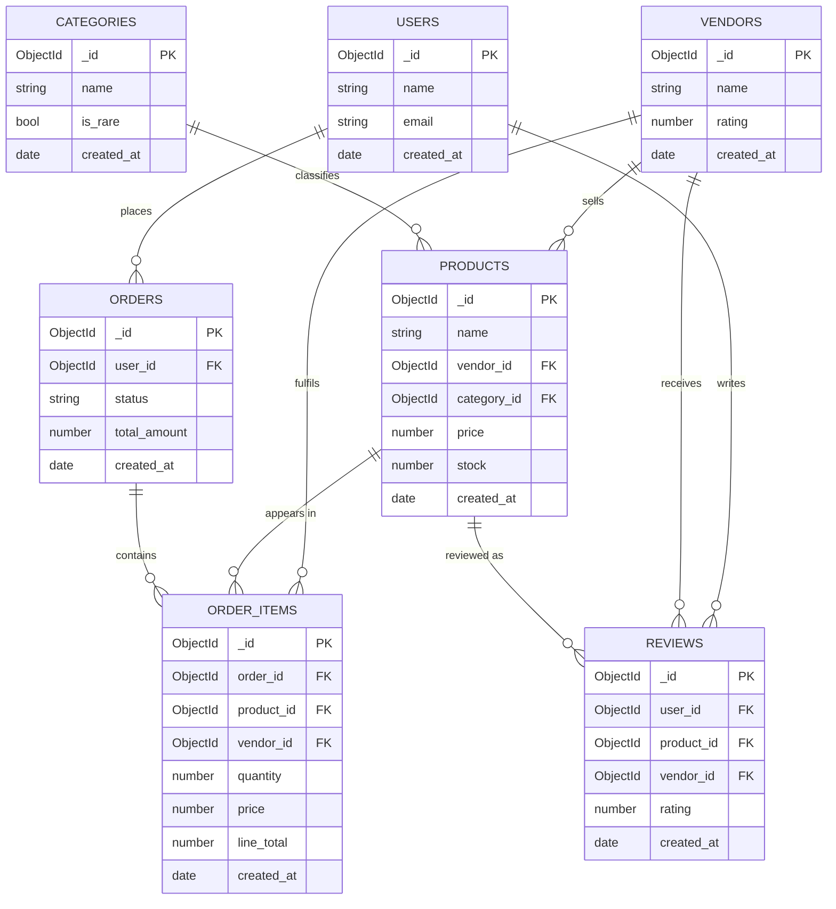

# Benchmark schema (`shopsphere_bench`)

The benchmark uses a **referenced (normalized)** schema in a dedicated database so that
"joins" are real joins between collections. This differs from the ShopSphere demo schema,
where `orders.items[]` is embedded. The demo database is never touched.

## ER diagram



## Collection mapping

| Entity | Collection | Key fields | Join keys (indexed) |
| --- | --- | --- | --- |
| users | `users` | name, email | `_id` |
| vendors | `vendors` | name, rating | `_id` |
| categories | `categories` | name, is_rare | `_id` |
| products | `products` | name, price, stock | `vendor_id`, `category_id` |
| orders | `orders` | status, total_amount | `user_id`, `created_at` |
| order_items | `order_items` | quantity, price, line_total | `order_id`, `product_id`, `vendor_id`, `created_at` |
| reviews | `reviews` | rating | `product_id`, `user_id`, `vendor_id` |

Every foreign key used by a query has a supporting index. `created_at` is indexed on
`orders` and `order_items` to support time-window filters.

## Deliberate data skew

The seeder (`server/scripts/seedBench.js`) is deterministic (`--seed`) and skewed so that
predicate transfer has something to exploit:

- **Categories**: category 0 is **rare** (~0.5 % of products, marked `is_rare: true`);
  category 1 is **very common** (~40 %); the rest share the remainder.
- **Vendors**: Zipf-like sizes (vendor 0 largest).
- **Orders**: spread uniformly over the **last 365 days**.
- **Products**: a small "hot" set (first 0.1 %, min 5) receives ~30 % of order-item picks.

## Scale flags

```
node scripts/seedBench.js --drop                     # full default scale
node scripts/seedBench.js --small --drop             # tiny dataset (tests/dev)
node scripts/seedBench.js --products=... --orders=... --items=... \
     --vendors=... --categories=... --users=... --reviews=...
```

Defaults: 200 000 products, 1 000 000 orders, 4 000 000 order_items, 200 vendors,
50 categories, 100 000 users, 1 000 000 reviews.

## Real mongod only

The benchmark talks to a **real, disk-backed `mongod`** (default
`mongodb://127.0.0.1:27018/shopsphere_bench`). `mongodb-memory-server` is used only at
`npm install` time to *download* the mongod binary; the library is never used at runtime.
Start the server with `npm run mongod` (see `server/scripts/mongod.sh`) or point
`BENCH_URI` at your own instance. `server/pt/benchDb.js` refuses any URI whose database is
not `shopsphere_bench`.
