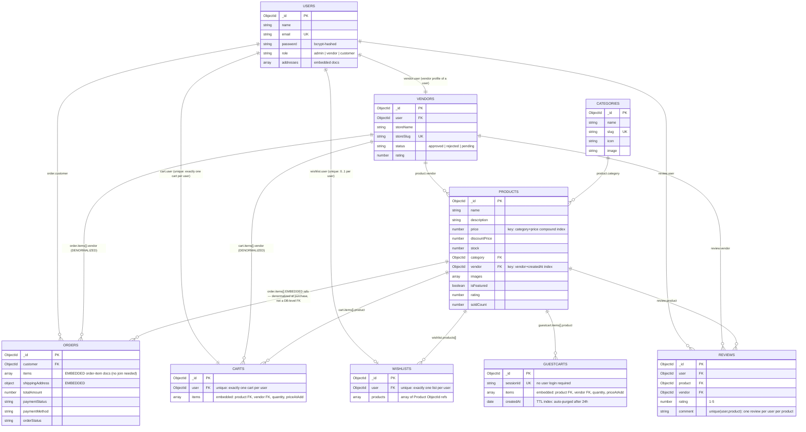
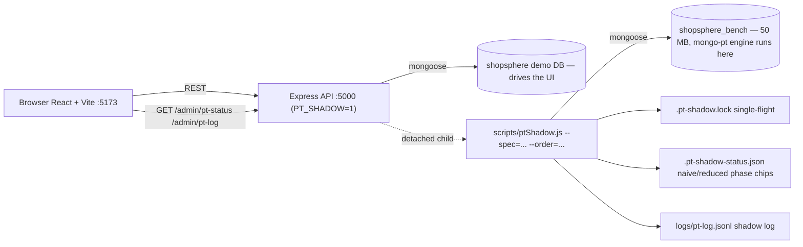

# ShopSphere database schema (Mermaid)

Two databases on one mongod (port 27018):

## 1. `shopsphere_bench` — the benchmark DB (referenced schema, real joins)

Mermaid:

```mermaid
erDiagram
    USERS["users — 20,000"] {
        ObjectId _id PK
        string email
    }
    ORDERS["orders — 100,000"] {
        ObjectId _id PK
        ObjectId user_id FK "index: user_id_1, created_at_1"
        date created_at "index: created_at_1"
    }
    ORDER_ITEMS["order_items — 400,656"] {
        ObjectId _id PK
        ObjectId order_id FK "index: order_id_1"
        ObjectId product_id FK "index: product_id_1"
        ObjectId vendor_id FK "index: vendor_id_1"
        number quantity
        number price
        number line_total "sum(avg) source"
        date created_at
    }
    PRODUCTS["products — 50,000"] {
        ObjectId _id PK
        string name
        ObjectId vendor_id FK "index: vendor_id_1"
        ObjectId category_id FK "index: category_id_1"
        number price
        number stock
        date created_at
    }
    CATEGORIES["categories — 30 (skewed: 1 rare 0.6%, 1 common 39.9%)"] {
        ObjectId _id PK
        string name
        boolean is_rare "selective filter flag"
    }
    VENDORS["vendors — 100"] {
        ObjectId _id PK
        string name
    }
    REVIEWS["reviews — 100,000"] {
        ObjectId _id PK
        ObjectId product_id FK
        number rating "filter: rating lte 2"
        date created_at
    }

    USERS ||--o{ ORDERS : "orders.user_id"
    ORDERS ||--o{ ORDER_ITEMS : "order_items.order_id"
    PRODUCTS ||--o{ ORDER_ITEMS : "order_items.product_id"
    VENDORS ||--o{ ORDER_ITEMS : "order_items.vendor_id"
    VENDORS ||--o{ PRODUCTS : "products.vendor_id"
    CATEGORIES ||--o{ PRODUCTS : "products.category_id"
    PRODUCTS ||--o{ REVIEWS : "reviews.product_id"
```

### The 4 benchmark specs (acronyms used in the log)

| Spec | Join chain | Selectivity |
|---|---|---|
| `rare_category_revenue_7d` | `cat → p → oi → o, v` | rare (0.6%) × 7d (1.6%) — *the big win* |
| `common_category_revenue_365d` | `cat → p → oi → o, v` | common (39.9%) × 365d — honest loss |
| `vendor_scoped_revenue_90d` | `v → oi → o, p` | 1 vendor × 90d |
| `user_vendor_category_spend_30d` | `u → o → oi → p → v, c` | 1 user × 30d — heaviest (6 relations) |

## 2. `shopsphere` — the demo app DB (embedded design)



## 3. Where everything runs — app wiring


